# The Horizon Broker

[](https://github.com/hamanakam1/horizon-broker/actions/workflows/ci.yml)
[](LICENSE)
[](https://www.python.org/)
[](Dockerfile)
[](https://github.com/hamanakam1/horizon-broker/releases)

**Asynchronous inference queue and fault-tolerance manager for a heterogeneous edge fleet.**

The Horizon Broker intercepts every request bound for the local Ollama/Qwen
endpoints and stops treating inference as a blocking call. It routes
long-horizon work, batches it for throughput, and guarantees that a dead node
does not lose an agent's work.

```text
   agent ──POST /v1/jobs──▶ ┌───────────────┐   flex window    ┌──────────────┐
                            │  Ingress API  │──(batching)────▶│  Scheduler   │
   agent ◀──202 + job_id─────└───────────────┘                  └──────┬───────┘
                                                                    │ PD-DAG
                                       ┌────────────────────────────┼───────────────┐
                                       ▼                            ▼               ▼
                                 ┌───────────┐                ┌───────────┐   ┌───────────┐
                                 │  M3 Max   │  prefill-heavy │ Pi decode │   │  Trailer  │
                                 │ (prefill) │◀───────────────│  (decode) │   │ (solar)   │
                                 └───────────┘                └───────────┘   └───────────┘
                                       │                            │               │
                                       └── heartbeat + checkpoint ─┴───────────────┘
                                                    │
                                             ┌──────▼───────┐
                                             │  EdgeRecord  │  (recovery state)
                                             └──────────────┘
```

## What it looks like

Both screenshots below are real output, captured by
[`scripts/make_screenshots.py`](scripts/make_screenshots.py) — the script starts
the real broker, talks to it over HTTP with the real operator client, and
paints the bytes the tools wrote. Nothing is hand-drawn.

The broker comes up, reports its health, and lists the fleet it can dispatch
to — each node with its role, its batch slot, its power headroom and the
models it serves:

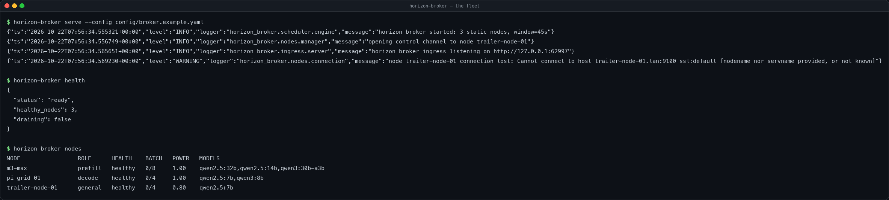

A Flex-tier job is submitted and held in the window instead of being executed
immediately. That is the whole point: the broker is deliberately slow when
throughput matters more than latency.

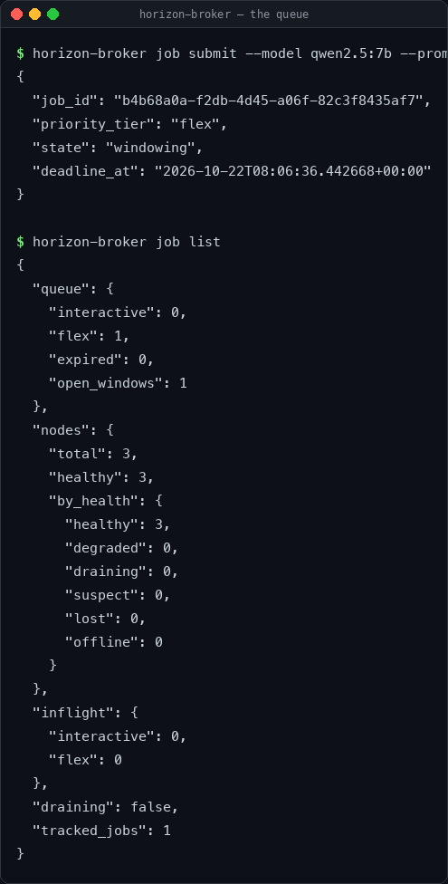

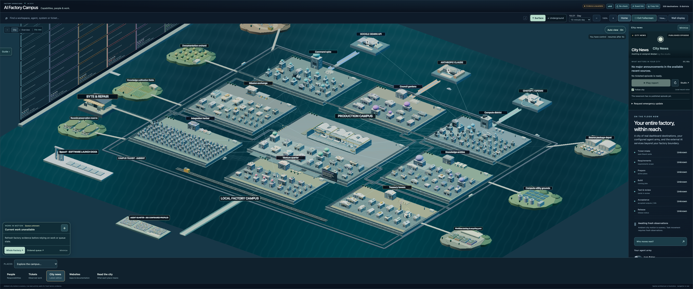

*The AI City: a live 3D view of the factory whose long-horizon work this
broker schedules. The districts are the destinations; the broker is the
inference fleet underneath them. The same view in ASCII lives in
[`docs/images/ai-city.ascii`](docs/images/ai-city.ascii).*

## Why

95 % of planned agent workloads are *long-horizon*: a recursive codebase scan,
a research sweep, a test-generation run. They do not need an answer in
milliseconds. The broker classifies them as **Flex tier** work, holds them in a
per-model window until the batch is worth executing, and dispatches them when
the hardware is ready — maximising Model Flop Utilization instead of
minimising latency.

The fleet is also fragile. A Raspberry Pi overheats. A solar trailer hits a
low-voltage shutdown. The broker treats hardware death as an expected event:
state is checkpointed to EdgeRecord continuously, and a lost node triggers an
automatic re-dispatch on a different node inside a 30-second budget.

## The four sub-systems

| Sub-system | Module | Responsibility |
| --- | --- | --- |
| Sleep-Time Scheduler | `horizon_broker/scheduler/` | Priority queue, per-model windowing, batch planning |
| Software-Defined Reliability | `horizon_broker/recovery/` | EdgeRecord snapshots, local journal, recovery coordinator |
| Heterogeneous Routing | `horizon_broker/routing/` | Arithmetic-intensity model, PD-DAG router, node placement |
| Throughput over Latency | `horizon_broker/scheduler/window.py` | Deliberate delay to build large batches |

Plus the fault-detection heartbeat (`horizon_broker/nodes/`) and the API
ingress (`horizon_broker/ingress/`).

## Install

Python 3.11 or newer.

```sh
git clone https://github.com/hamanakam1/horizon-broker.git
cd horizon-broker
python3 -m venv .venv && source .venv/bin/activate
pip install -e ".[dev]"
```

## Run

```sh
cp config/broker.example.yaml config/broker.yaml   # edit to taste
python -m horizon_broker check-config --config config/broker.yaml
python -m horizon_broker serve --config config/broker.yaml
```

### Container image

A published image is built and smoke-tested on every release tag.

```sh
docker pull ghcr.io/hamanakam1/horizon-broker:0.2.0
docker run --rm -p 8791:8791 ghcr.io/hamanakam1/horizon-broker:0.2.0
```

The image runs as a non-root user and keeps its journal on
`/var/lib/horizon-broker`. See the
[package on GitHub](https://github.com/hamanakam1/horizon-broker/pkgs/container/horizon-broker).

The broker listens on `127.0.0.1:8791` by default. `check-config` validates
the file and the fleet before the broker starts, so a broken configuration
fails loudly instead of at the first dispatch. `SIGTERM` drains: the broker
stops accepting work, finishes the in-flight jobs (up to
`broker.drain_timeout_seconds`) and exits.

## Use

### The OpenAI-compatible way (drop-in)

Agents, SDKs and CLIs already speak the OpenAI chat-completions API. Point
their base URL at the broker and the request is queued, categorised and
routed like any other work:

```sh
curl -sX POST http://127.0.0.1:8791/v1/chat/completions \
  -H 'content-type: application/json' \
  -d '{
        "model": "qwen2.5:7b",
        "messages": [{"role": "user", "content": "Map every call site of the ingestion pipeline"}],
        "max_tokens": 4096
      }'
```

```json
{"id": "chatcmpl-0f2c...","object": "chat.completion",
 "choices": [{"index": 0, "message": {"role": "assistant", "content": "..."},
              "finish_reason": "stop"}],
 "usage": {"prompt_tokens": 12, "completion_tokens": 4096, "total_tokens": 4108}}
```

`"stream": true` returns server-sent events in the OpenAI chunk format.
Two extension fields let a caller steer the broker: `horizon_priority_tier`
(`interactive` or `flex`) and `horizon_max_acceptable_latency_ms` (the
latency budget that decides the tier). Other clients ignore them.

### The native API

Submit work directly. The broker categorises it: a latency budget at or
below `interactive_latency_threshold_ms` (2 s by default) is dispatched
immediately, anything slower is sleep-time compute.
```sh
curl -sX POST http://127.0.0.1:8791/v1/jobs \
  -H 'content-type: application/json' \
  -d '{
        "priority_tier": "flex",
        "payload": {
          "model": "qwen2.5:7b",
          "prompt": "Map every call site of the ingestion pipeline",
          "expected_output_tokens": 4096
        },
        "max_acceptable_latency_ms": 3600000
      }'
```

```json
{"job_id": "0f2c...","priority_tier": "flex","state": "windowing","deadline_at": "..."}
```

Poll it:

```sh
curl -s http://127.0.0.1:8791/v1/jobs/0f2c... | python3 -m json.tool
```

### API

| Route | Purpose |
| --- | --- |
| `POST /v1/chat/completions` | OpenAI-compatible completion (streaming or not) |
| `GET /v1/models` | The models the mesh can serve |
| `POST /v1/jobs` | Submit a job (202 + `job_id`); 429 when the queue is full, 503 while draining |
| `GET /v1/jobs/{job_id}` | Job status and result |
| `DELETE /v1/jobs/{job_id}` | Cancel queued or running work |
| `GET /v1/nodes` | The fleet view (capabilities, health, load) |
| `POST /v1/nodes/{node_id}/heartbeat` | HTTP heartbeat fallback |
| `GET /v1/queue` | Queue occupancy and in-flight counters |
| `GET /v1/config` | The effective configuration |
| `GET /healthz`, `GET /readyz` | Liveness and readiness |
| `GET /metrics` | Prometheus text exposition |

Submission is idempotent: posting the same `job_id` twice returns the job
that is already known instead of starting the work again, so a caller that
retries after a timeout cannot double-execute.

### The operator CLI

```sh
horizon-broker-cli nodes
horizon-broker-cli job submit --prompt "Map the ingestion pipeline" --tier flex
horizon-broker-cli job status <job-id>
horizon-broker-cli job list
horizon-broker-cli health
```

The CLI talks to a running broker over its HTTP API, so it can be run from
another machine (`--base-url`).

### In pictures — captured live

These are the script-free captures: a broker started on this machine, real
requests over HTTP, the real operator client, and the bytes the tools wrote.
(The scripted renders above are the reproducible counterpart.)

Every screenshot below was captured from a broker running on this machine
against a live Ollama engine, with a three-node demo fleet (a prefill node, a
decode node and a solar trailer) pointed at the local engine.

| The fleet | A job end to end |
| --- | --- |
| 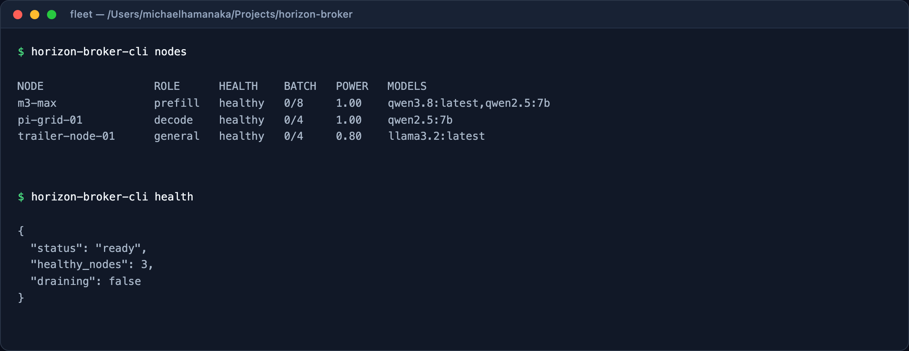 | 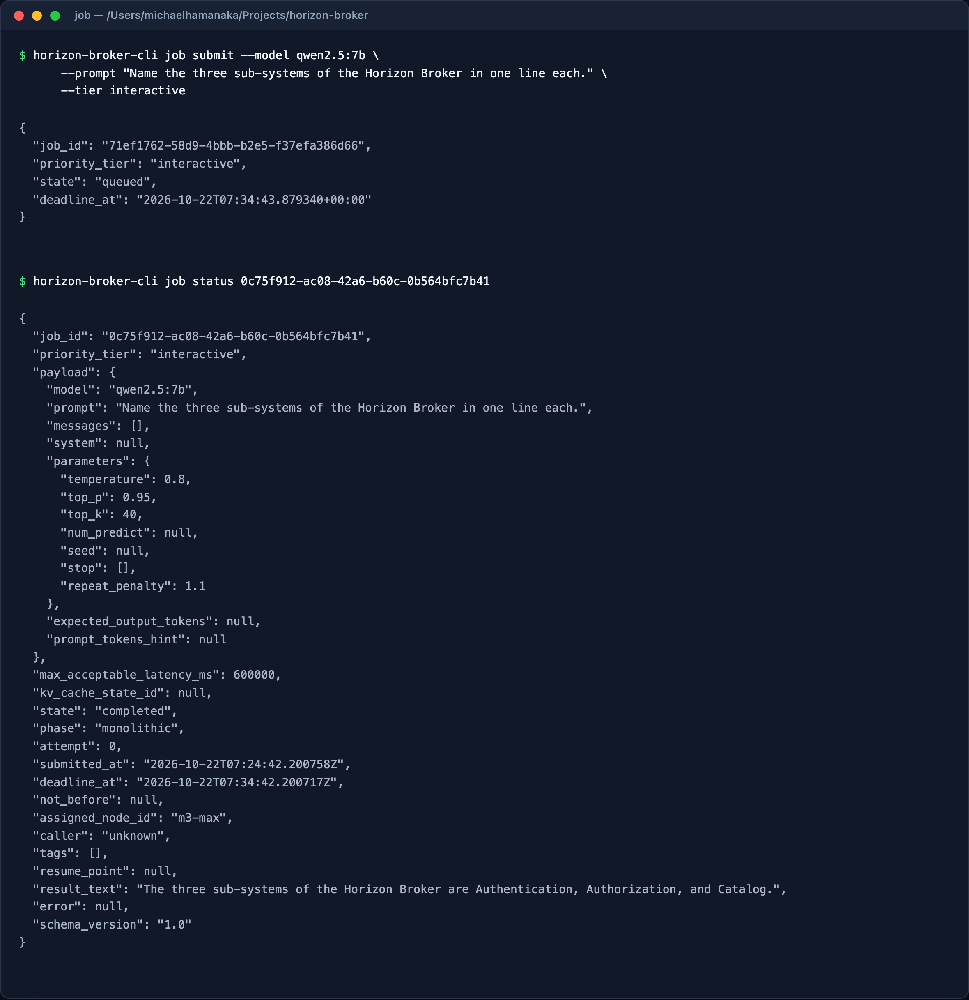 |

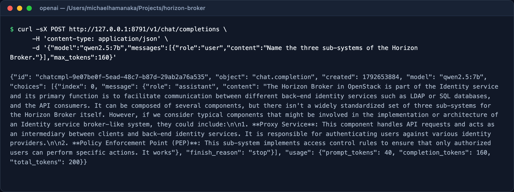

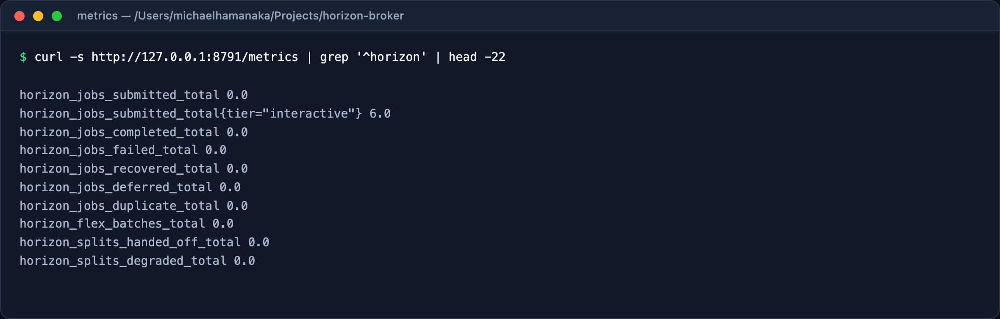

<details>
<summary><strong>The AI City in ASCII</strong> — 300 columns, 44 rows</summary>

Every district of the factory that this fleet serves, rendered from the live
3D render: the pale slabs are the district plates, `o` are building walls,
`#` are roofs, `*` are landscape and `@` are the accented platforms. The
full-resolution file is [`docs/images/ai-city.ascii`](docs/images/ai-city.ascii).

```text
         @             @             @            @@             =           ooooo@                                                oo                                       =@@@##====                                                                                                    # ## ## ###### #  
         @             @             @            @@             ==== =   ooooo                                                   ooo                                    @@####GOOGLE GEMINI API                                                                                                            
         @             @             @            @@             ==== ooooDocumentation orchard====                               oo=@                                 @@@@###o#######@@@@                                                                                                                  
         @             @             @            @@             = oooooo           ooo*****@**@@@o                            @@oo   @@@=@                               @@@#####@@@@@@@                                                                                                                   
 ### =   @             @            @@            @@            ooooo           ooooo*@***********o**@@                     @@@             ====Command spire=         @@@@@    @@@@@@                                                                                                                      
         @             @         @   @            @@ ==  =  oooooo             ooooo***************oo@@                  @@               =====@ *==##@@##         @@@@@@@                                                                                                                                  
         @             @      @      @            @@===  oooooo                **ooooooooo**o##oooooooo              @@@             ##@============@@@@@@=@=    @@@@@@                                 ANTHROPIC CLAUDE=====                                                                               
         @             @  @         @@            @@  ooooo                             oooo*ooo      ooooooo     @@@              ===#@=o#@=========@@@@@=@@@=@==@                                               ###ooo=                                                                                   
         @            @@         @   @            oooooo                                                   oooooo=@            @@==o#oo@=*@@=o##==@@========###@=  @=@@=                                       @@###*##ooo@###                                                                              
         @         @@  @     @@      @  =  =   ooooo######                                                 @@@@@  =****     @==#@@=#@@=@====@@@@==#@==##@===###=======* *===@@                                @@@@@####@o####@@@@                                                                           
         @      @@     @   @         @@@=   ooooooKnowledge cultivation fields                         ##@=     @**     =*@=========@@=#@===@o#===@#@==#@==@===@========##==@ *@===                            ****@@@##@@@@@@@                                                                             
         @   @@        @             @= oooooo            ooo****@*o**@@##                           @@@    @=@@  Mission exchange======@@=##@===@@@@==#===@@=#@==========@@        ===@=Council gardens     ######  ****@@                                                                                 
         @@         @  @             oooooo           oooooooooo@*oo@@@o###@@                    @@@@    @===========######    ==*=o===========##=@@#@===#@#@==o===@===@@@@       oooooo *=@  @====#==@  o######=@        @                        CHATGPT / OPENAI                                         
         @      @@     @  =       ooooo@             ooooo****oooooo@@@@ooo*@@                @@@    #@===============*###@oo       ==*===*=========@@=o==@@====@===@@@        oooooooooooooo#####@@@  ######                                             ####=#####                                        
         @  @ @        @@@@@  oooooo     #BYTE & REPAIRooooooooo@@@@ooooooo**              @@@    @==o#@@@=####ooooooooo@@ooooooo         ==*o*o*=======@===@@==@@@@        o===oo#oooooooooo**o#@@####=@@@                                             @##@#####@                                          
         @@            @=  oooooo       @####o@@@@@@@@      oooooooooooo   #######     @@@@   @o##========###@@#####==========@=======         ==*==o*======@@@@@       @===#o###==#@==oooooooooooooo###o  *@@=@@                                    @@@##########@@@@@                                     
         @              oooooo        oooo*@@###@@@@ oo                         o######@   @====#===###==##====@#@@====##================##o         ==*=o@@*@**     o===o###==*@@======#o###oooo##oooooooooooo  @@@@@       @                      **@@@@@@@@@o###@@@@@                                    
         @           ooooo           ooooooooo****oooooooo                       @@@   =@@oo=*=oo=======##@=====@=###==##=o#==###ooooooooooo@@                  =**@ooo===oo##====##@*==@==@====*o@@ooooooooooooo#oo@@@===@@  @   Compute district    ##****@@@@@@@@                                        
         @@@@@=  oooooo                   oooooooooo@   ooooooo              @@@Integration harbor====###==o#@=#o#===o=o@==##==@==o#@=ooo@@@@      @@            PRODUCTION CAMPUSoo#@=@=##===o##======ooooooooooooo@       ==@@@      ########=  #######    ****                                           
         @@=  oooooo         Records preservation reserve     ooooooo     @@@  @@@@*@===@@ ====@oo==========o@=o@==o==@=@==o@==o@====@@@@       ===========      ################# ======###==##=====o##@==@=oooo@@        @===@@ ===##@###    #######                                                      
           ooooo                ooooooooo**@##                     ooooo@@ @===========    o##=#=###@@@oooooo=====o@=@==@=@@=@====@@@@      @===================@           @@@@=@ooooo=======##@==###==@===@o@@       @###==========***##@@=#####                                                          
         oooo               oooooooooooooooooo**@@                 @@@ooo@@@=@============#oo=#  @=@@@@=*=@=*oooo======@@=@==@@@@@@   @@@@==============#####=========@           ****==ooooo======##@===o@@@        @@=@o@=@====#@==**@*@@####@*@@                                                         
                           oooooooooooooooooooo**@*             @@@==@=@=oo==@@@=@=@======ooo@@####   @@===@=***=o==oooo==@@@@@@@@=  @=============o@@@oo########=##======@=           =**@=**@ooo===@@@@        @##=@#@===#@@=o@*@=====*@===@#=#@ @==@=                                                    
                           **oooooooooooooooooo####          @@@ =o@o==@@o@======@o=@=@==========o###===    ====@===**o=@@@@@@@@@###============ooo@@@=@@=@@=o###########=========           =*@@@@@@*=@@    @@@@@=@@==@@==@*@=*#@==@@==##==@=@=@======  @*@@@                          Source package depot
                                  ooooooooooo     ##########@==========@=@@@=o@@@@@@=@@===o#@=================    @@=@=@@@@@@ @@=####@============@@=====##==o@@===#############=======@       =*=*@    **@@@====Knowledge archive==@ooo@=@=@@===========##== *==@@@ #@                  ##o########        
                                                      @@@@o*  =*o*=========@=o@==@@==@@@@@@@@@==@o==============#=@@   @@@ @###====@@==#oo@@====================##=#=====#######@@==========@@@@@@@@@@@@@@@@@@@@@@@======@==#=*@==@=@=@=@=@=#@=@=@==========@@      *@==@@        #####oooo###########      
                          ##SpaceY - SOFTWARE LAUNCH DOCK         =*==o*=========o===@@@@=@@=@=@=o@oo@===========@@@    @===o#@@===##===o@@==o##@======================#o===@@@@@==============#@@@@@    @@@@*@@@@*@@@=========o==@=@@@o@=@=@@@@===@=@===@@@        @#############oooooooooo@ooo#####@@@@   
                          @o#### =####@@#@@@#@   @@ **                  =*=oo=========@@@==@===@=@==@@@@@=@=@=@@@@    *@=========#####===##===Venture quarter=============@@@@@================@@@@@     @@@@@@@    =@@@==@@========@=@#=@@=@===@====@@@@           =@@           oooooooo#oooooooo@o****   
                        ##@o@@@#@##@##########@     @CAMPUS TRANSIT - AMBIENT=*=*oo=======@=@=oo==@o=@===@@@@@        @@===========@@==oo###==###==oo@@=##*o@@===========@@=================@@@@@      ##ooooooo@   ##########= *========@@=@o====@@@@          @@@                 oooooooooooooooo***     
                    #######o@@######                    =#######=####              ===*o*==========@@=@@@@@              @@=o=======o  #######o @@==#==*o@@==@==####=====================@@@@@      @@###@oooooooooo#####       =*=*oo*=====@==@@@           @@@                                            
                     ############=########                     =@@=@@                    ==*=oo====@@@##              ###oooooooooo==#####=====@@==#@@=###===oo=@=@@===#oo============@@@@@      ###==@o#@@oooooooooooo@o#####       ===*oo@@=**          @@@                                               
                           #########====########                     =@@@=*             =     ====@@  #             @=o##@ooooooooooo***@@@===@=====@==o@@=#@@==@====o##==@=#@====@@@@@      ##@==o@@==#=====o=o#oooooooooo####ooo              ==**@ @@@@                                                  
                                 ########=====########                     ==@=@*   ooo@@@@                     ##===ooo===@@@=ooooooooooooooo=oo==========o@@=##**@==o====@@@=@@@@@@@    @#==@@=@@====@=====o@===@@##@oooooooooooooooo#        @  @@@                                                      
                                      o########=######                           @@===    o=ooooo            @o==o@==o=@==#==###@==##oo#oooooooooooo======ooooo @===#===@===@@@@@@@   @@@===@===#@=o#@=oo=====o@==#===@@==ooooooooooooooooo@   @@@@                                                         
                                            #######                                    @@@*@    ooooooo    =ooooooo===@==##@=###@====###@=##ooooooooooooo#=====  ==*=@==@@@@@@@@@@  @@Treasury towers@====###===oo=@==o@===@==#@=o#oooooo@  @@@@ Compute utility grounds                                    
                                                          AGENT QUARTER - 280-COMMAND PEOPLE LAB=@   ooooooo===*oooooooooo===*@@=#@@==oo@==@===o#ooooooooooo@===@*o***@@@@    @@@@@@@@@@@*=*oooooooo===o@@=#==o#@=@=#==@==o@@=o@==@==o@  #####                                                              
                                                                                                  @@=@*   LOCAL FACTORY CAMPUSo===@==#@@==@==o@==o@=@oooo@@         ==@   @oooooooo   *  *########* ooooo===@==oo===#==o@==@==@@==o@  @=@    o######       ############@                                    
                                                                                                        @@@@=    ooooooo=@*=ooooooooo===oo==@==o@=@=o@@@               @=ooooooooooooooo#####@@@=@==**=o*ooooooo====#@=#@==@==@@  @@@@             #####ooooo@@@oo@*@@oo                                    
                                                                                                          ###@@@#######ooo##oo==*ooooooooo===@===o@@               @@====oo###oooooooooo*@o@@o    =@@@@@==**=oooooooo===@==o@  @@@                 ooooo@o@@@@@o@@@@@ooo*@@@                                
                                                                                                         ###################ooooooo==*=*ooooooo@@               @@=###oo###=====o##ooooooooooooooooo    =@@@=@===*o=ooooo@  @@@                   *ooooo@oo@o#@oo@#oooooo****                               
                                                                                                                         @@=@*@   oo=oooo#==@@               @o===*oo##@=========@@=o###oooooWorkflow sorting & recycling yard                     **oooooooooooo=@@oooo**                                  
                                                                                                                               @@@@*    oooooo             ==oooooooo=@====o#@@=##====@=o##@=oooooooooooooooo##o  @@@=@@                                   oooooooooo                                       
                                                                                                                                    @@@=@*    oooooo          =*=ooooooooo==@==o#@@=###======o#@=###ooooooooooooo@##@                                                                                       
                                                                                                                                          @@@*=****ooooooo         ==*=ooooooooo====o@@=#=@======#@#=o##oooooo@@@@                                                                                          
```

</details>
## Configuration

Defaults live in `horizon_broker/config.py`; `config/broker.example.yaml`
documents every knob. Environment variables override the file:

```sh
HORIZON_BROKER_PORT=8791
HORIZON_BROKER_OLLAMA_BASE_URL=http://127.0.0.1:11434
HORIZON_BROKER_LEDGER_BASE_URL=http://127.0.0.1:8787
HORIZON_BROKER_WINDOW_SECONDS=45
HORIZON_BROKER_RECOVERY_BUDGET=30
HORIZON_BROKER_MAX_QUEUE_DEPTH=10000
EDGERECORD_TOKEN=...        # the ledger token, read per request
```

## Documents

* [`docs/ROADMAP.md`](docs/ROADMAP.md) — the long-term plan: what the software
  becomes, in which order, and what each phase must prove
* [`docs/ARCHITECTURE.md`](docs/ARCHITECTURE.md) — directory tree, subsystem map, fault timeline
* [`docs/CONTRACTS.md`](docs/CONTRACTS.md) — the data contracts and their JSON Schema
* [`docs/RUNBOOK.md`](docs/RUNBOOK.md) — operating the broker when hardware dies

### The plan in pictures

**Target architecture at v1.0** — what is built today (solid) and what the
scale phase adds (dashed):

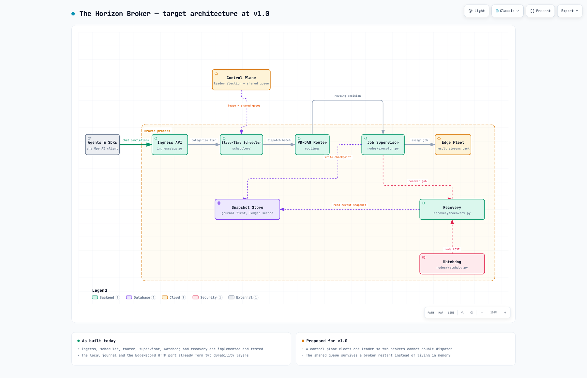

**How the software gets built** — phase, gate, edge trial, release:

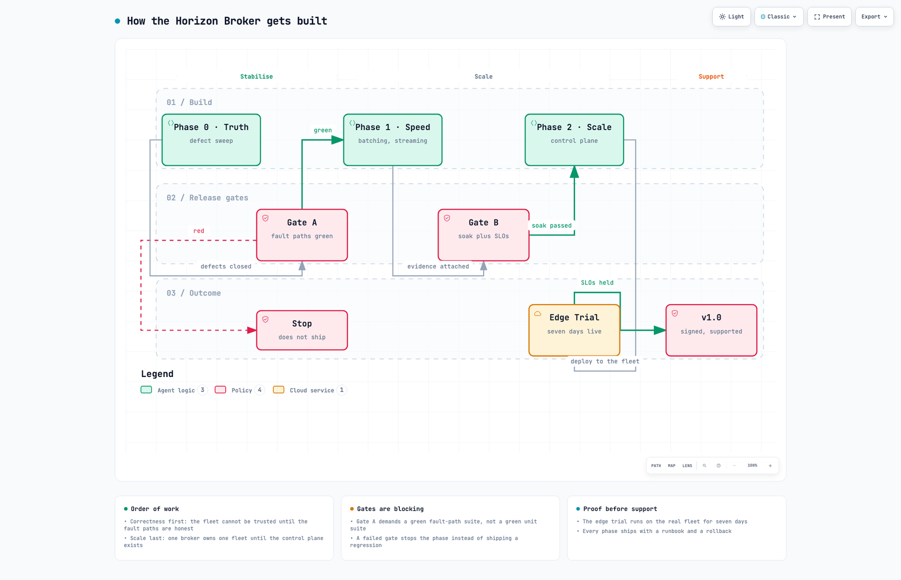

**The job state machine**, including the recovery loop and the terminal exits:

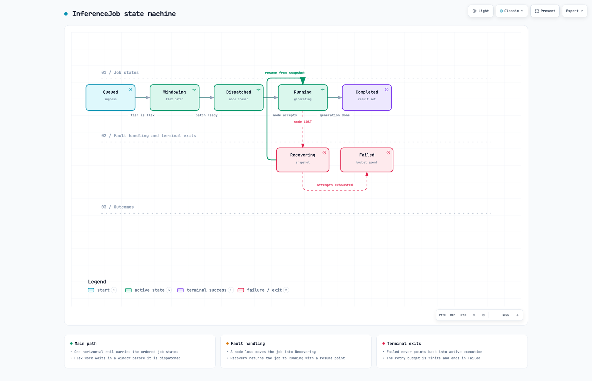

**One job across a node loss**, from acceptance to completion:

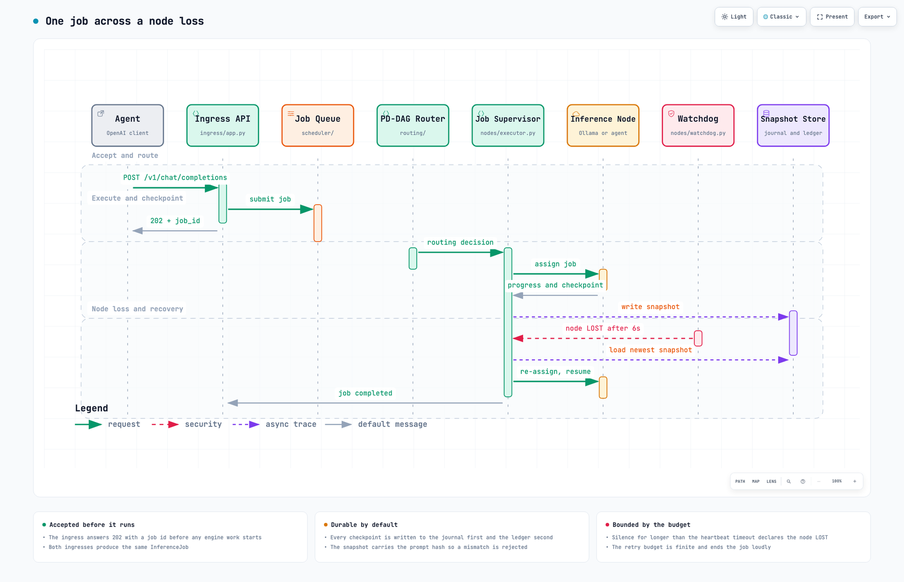

Each diagram is generated from a typed specification in `docs/diagrams/`,
validated to the showcase standard and published to the local dashboard
(`http://127.0.0.1:7878/#archify`); the delivery receipt is
[`docs/diagrams/delivery-receipt.json`](docs/diagrams/delivery-receipt.json).

## Development

```sh
make dev
make test        # pytest
make lint        # ruff
make typecheck   # mypy --strict
make schemas     # regenerate schemas/*.v1.json
```

## Status

**v0.2.0 — alpha.** The scheduler, router, heartbeat, checkpointing and
recovery paths are implemented and covered by tests (131 of them). The
prefill/decode split runs end to end for engines that can export a KV cache
(enable them in `routing.kv_handoff_models`); Ollama cannot, so the broker
degrades a split to a whole-job run and says so in the log and the
`horizon_splits_degraded_total` metric.

Not done yet: a real EdgeRecord ledger adapter (the HTTP port is exercised
through a fake in the test suite) and multi-broker coordination (one broker
owns one fleet).

The long-term plan — what the software becomes, in which order, and what each
phase has to prove before it is allowed to ship — is in
[`docs/ROADMAP.md`](docs/ROADMAP.md). The first phase is not a feature: it
closes the defects that make the broker's behaviour and its documentation
disagree.

## License

MIT. See [LICENSE](LICENSE).
